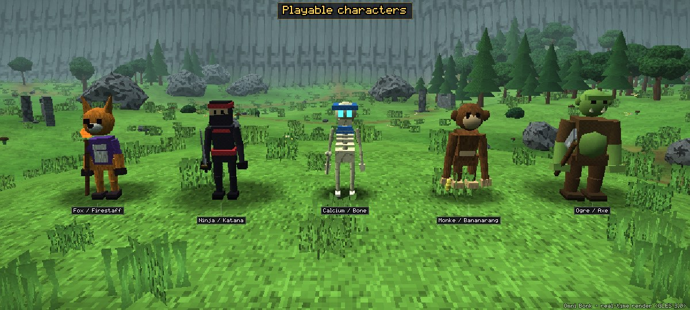
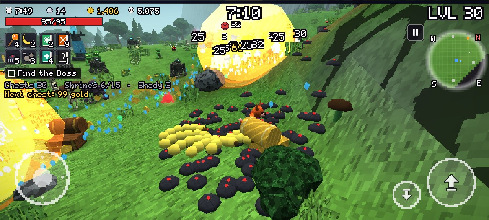
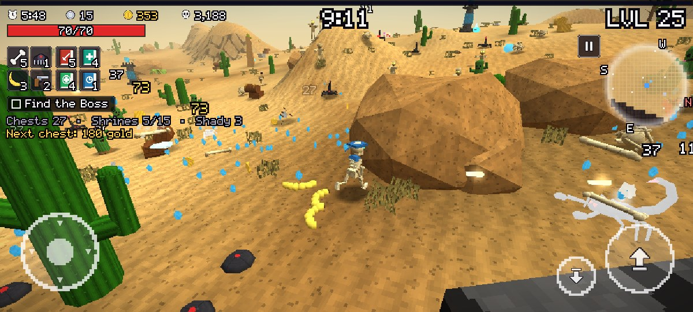
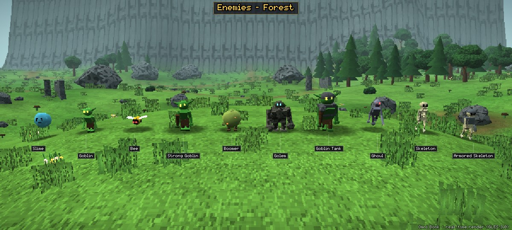
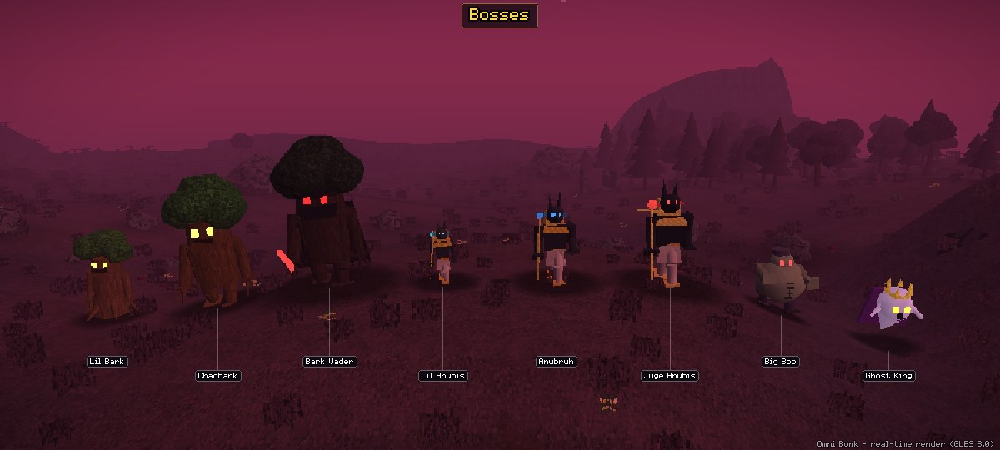
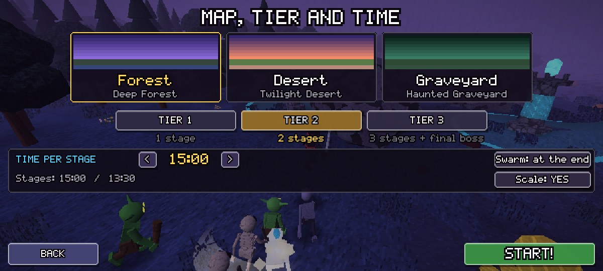

# Omni Bonk Mobile

Roguelike de sobrevivência em 3D para Android, inspirado no **Megabonk** (vedinad, 2025): mesmo estilo low-poly com texturas pixeladas, animação *stepped* (12 fps, tipo Aranhaverso / Gato de Botas 2), mesmo catálogo de inimigos e a mesma progressão de dificuldade. A diferença é que o **tempo por estágio é ajustável** (padrão de 15 min em vez dos 10 min do original), e várias melhorias de QoL vêm dos mods mais usados pela comunidade.

> Projeto de fã, sem vínculo com o Megabonk nem com o autor. Nenhum asset do jogo original é usado: modelos, texturas, ícones, fonte, música e efeitos sonoros são gerados por código no estilo do original.



| | |
|---|---|
|  |  |
|  |  |
|  | |

## Conteúdo

| | |
|---|---|
| Mapas | Forest, Desert e Graveyard, cada um em 3 tiers com paletas próprias (Green/Deep/Cursed Forest, Crusty/Twilight/Blood Desert, Graveyard/Haunted/Cursed Graveyard) |
| Inimigos | 43 no total, com elites, 6 minichefes, 8 chefes (incl. o Ghost King da arena final do Tier 3) e o enxame final |
| Personagens | Fox (Firestaff), Ninja (Katana), Calcium (Bone), Monke (Bananarang), Ogre (Axe), cada um com passiva |
| Armas / Tomos / Itens | 30 armas, 23 tomos, 86 itens nas raridades Common, Rare, Epic e Legendary |
| Interagíveis | Baús (normal e dourado grátis), Charge Shrines (torres de upgrade), Greed, Cursed, Challenge, Moai, Shady Guy, Microwave, Shrine of Succ, potes, abóboras, potes de prata, tumbleweeds, chaves da cripta, portais |
| Powerups | Escudo, Relógio, Ouro x2, Fúria, Ímã e Bomba |

## Tempo por estágio e progressão

- Opções de 10, 12, **15 (padrão)**, 20, 25 e 30 min, ou infinito (sem timer).
- Os eventos do estágio (enxames, minichefes, enxame final) são posicionados como fração do tempo, então a curva de dificuldade continua igual com qualquer duração.
- Estágios 2 e 3 usam 90% e 80% do tempo, como no original (dá para desligar).
- Modo do enxame final: quando o timer acaba (original) ou só depois de matar o chefe.

## QoL vindo dos mods da comunidade

Tempo de estágio ajustável · medidor de DPS e tabela de dano no fim da run (StatHUD) · contadores de baús/shrines/Shady/Moai e custo do próximo baú (SpawnTracker) · abertura instantânea de baús · auto-bhop · animação stepped 6/8/12 fps ou suave · opacidade dos efeitos · escala de renderização · limite de inimigos · mapa completo · FOV e distância da câmera · modo canhoto · escala da interface · vibração · limite de FPS · banir/rerrolar/pular upgrades.

## Controles (touch)

- **Joystick** (esquerda): andar. Os ataques são automáticos, como no original.
- **Arrastar na metade direita**: girar a câmera.
- **Botão grande** (direita): pular (segure para o auto-bhop); **botão menor**: deslizar; o botão de interagir aparece perto de baús e shrines.
- **Pausa** e **minimapa** no canto superior direito; o minimapa abre o mapa completo.
- Botão *voltar* do Android: pausa / volta de tela.

## R36S e outros portáteis Linux

Port *Ready to Run* em `ports/r36s` (aarch64, SDL2, OpenGL ES 3.0), no formato do PortMaster. O pacote `OmniBonk-R36S.zip` sai na Release **r36s-mais-recente** a cada push.

1. Extraia o zip dentro da pasta `ports` do cartão (partição EASYROMS): ficam `OmniBonk.sh` e a pasta `omnibonk`.
2. Reinicie o EmulationStation. O jogo aparece em Ports.

| Controle | Na partida | Nos menus |
|---|---|---|
| Analógico esquerdo / D-pad | andar | navegar |
| Analógico direito | câmera | rolar listas |
| A ou R1 | pular | confirmar |
| B ou L1 | deslizar | voltar |
| X ou R2 | interagir | |
| Y ou L2 | mapa completo | |
| Start | pausa | ação principal da tela |
| L1 / R1 | | trocar de aba |
| Select + Start | salvar e sair | salvar e sair |
| L3 + R3 | captura de tela (`omnibonk/conf/`) | |

A interface se adapta à tela 4:3 de 640×480 e toda a navegação é por foco. O arquivo `omnibonk/log.txt` registra firmware, driver de vídeo, controle detectado e FPS a cada 10 s.

O binário depende só de `libSDL2-2.0.so.0` e de glibc 2.27 ou mais nova; as funções de OpenGL ES são carregadas em tempo de execução pelo SDL. Testado no CI com o binário aarch64 real rodando em QEMU sobre Debian 13 (a base do dArkOS).

## Tecnologia

- C++17 com motor próprio, OpenGL ES 3.0, `NativeActivity`, AAudio, sem Gradle e sem engine.
- Renderização instanciada, *flip-book* de animações pré-calculadas a 12 fps, *vertex snapping* estilo PS1, texturas 64×64 com filtro *nearest*, neblina exponencial, *decals* que acompanham o terreno, escala de render com *upscale* nearest.
- Áudio procedural: efeitos sintetizados e trilha chiptune por mapa.
- `src/main_desktop.cpp`: harness *headless* (Mesa EGL surfaceless) que gera screenshots, pranchas de arte e simulações de balanceamento com um bot.

| Pasta | Conteúdo |
|---|---|
| `src/` | jogo (dados, modelos, mundo, combate, render, UI, áudio) e plataformas Android (`main_android.cpp`), SDL2 (`main_sdl.cpp`) e harness (`main_desktop.cpp`) |
| `android/` | `AndroidManifest.xml`, `MainActivity.java`, recursos e ícones, keystore de teste |
| `ports/r36s/` | R36S package: `OmniBonk.sh`, `port.json`, `gameinfo.xml`, README |
| `scripts/build_r36s.sh` | cross-compila o port SDL2 para aarch64 e gera `build/OmniBonk-R36S.zip` |
| `scripts/r36s_smoke.sh` | roda o binário aarch64 em QEMU + Debian 13 e captura telas |
| `scripts/build_apk.sh` | build do APK: NDK/CMake → aapt2 → javac/d8 → zipalign → apksigner |
| `scripts/emulator_smoke.sh` | teste no emulador do CI (instala, abre, captura telas e logcat) |
| `.github/workflows/android.yml` | CI: build do APK, artefato, teste no emulador, release em tags `v*` |
| `.github/workflows/r36s.yml` | CI: build do pacote do R36S, release e teste em QEMU |

## Build

**GitHub Actions:** todo push compila o APK (artefato `OmniBonk-apk`). O job do emulador sobe o APK num Android 30 x86_64, abre a tela título e três runs de demonstração jogadas pelo bot, e publica screenshots e logcat no artefato `emulator-screenshots`. Um push de tag `v*` também cria uma Release com o APK.

**Local** (Linux, com Android SDK + NDK, JDK 17+, CMake):

```bash
export ANDROID_HOME=~/Android/Sdk
bash scripts/build_apk.sh            # gera build/OmniBonk.apk (arm64-v8a, armeabi-v7a, x86_64)
adb install -r build/OmniBonk.apk
adb shell am start -n com.blackcocada.omnibonk/.MainActivity --es args "demo=1,0"   # run demo com bot (personagem,mapa)
```

**Harness desktop** (Linux com Mesa: `libegl`, `libgles2`, `libpng`):

```bash
cmake -S . -B build-desktop -G Ninja && ninja -C build-desktop
./build-desktop/omnibonk_desktop --scenario art  --out shots --size 2400x1080
./build-desktop/omnibonk_desktop --scenario game --out shots --size 2400x1080
./build-desktop/omnibonk_desktop --scenario balance --map 0 --char 1 --minutes 15
```

Requisitos do aparelho: Android 8.0 (API 26) ou mais novo, com OpenGL ES 3.0.

O APK é assinado com uma chave de teste (`android/omnibonk-test.keystore`, senha `omnibonk`). Para publicar, troque pelas variáveis `KEYSTORE`, `KEYSTORE_PASS`, `KEY_ALIAS` e `KEY_PASS` (por exemplo, via *secrets* do GitHub).
